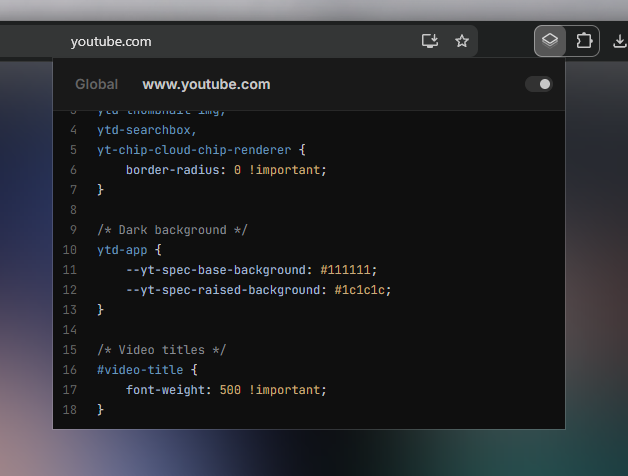

# *Layer*

Layer is a minimal browser extension for Chromium-based browsers that lets you customize websites with CSS. Write global styles or styles for individual websites directly from the browser toolbar. Changes are saved automatically and applied to matching open pages without reloading.

## *Preview*

## *Install*

1. Extract the archive to a folder you want to keep.
2. Open `chrome://extensions` and turn on **Developer mode**.
3. Click **Load unpacked** and select the folder containing `manifest.json`.

## *Styles*

- Switch controls the selected stylesheet. Turning it off keeps its text.
- Site rules follow global rules. Each hostname has its own stylesheet, including subdomains. An embedded web page uses its own hostname.
- Layer adds user-origin CSS. Use `!important` to override a declaration supplied by the website.
